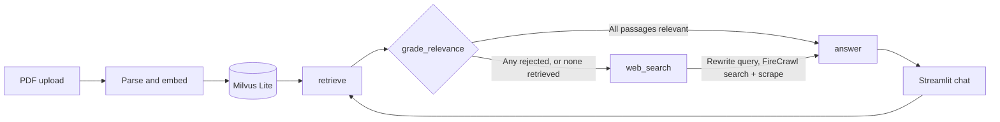

# FireCrawl Agentic RAG


A question-answering system that **checks its own retrieval before it answers**. It retrieves passages from uploaded PDFs, asks an LLM to grade each passage for relevance, and **falls back to a live FireCrawl web search** when the documents do not cover the question. The answer is generated from the surviving passages plus the scraped web pages, with the web sources listed next to it.

The pipeline is a LlamaIndex event-driven workflow with Milvus Lite, FastEmbed and a Streamlit chat UI. The default stack runs on a 16 GB laptop: the LLM is a local [Ollama](https://ollama.com) model (`qwen3:8b`), so the only external service is FireCrawl. Any LiteLLM-supported model, including OpenAI, works by changing one variable.

## What was verified

This project has no benchmark yet. These are the checks that were actually run.

| Check | Result |
| --- | --- |
| Workflow routing, offline (fake LLM and fake FireCrawl) | **4 tests pass**: relevant passages skip the web, a rejected passage is filtered out and triggers a search, no index means web-only, a FireCrawl failure is reported instead of raised. |
| Real PDF indexing and retrieval | A PDF was parsed, embedded and stored in Milvus Lite, then retrieved in two consecutive queries on separate event loops, which is how Streamlit calls the workflow. Run with `bge-small-en-v1.5` and a fake LLM. |
| Live end-to-end query, web-only | Real FireCrawl search plus local `qwen3:8b` on an Apple M5 with 16 GB: query rewritten, 3 pages scraped, cited answer returned in **69 s**. One run, not a latency benchmark. |
| Streamlit app | Loads headless with no exceptions. PDF upload through the UI with the real LLM was not part of the automated checks. |

## How it works



`CorrectiveRAGWorkflow` in [workflow.py](workflow.py) has four steps:

1. **retrieve** – top-k passages from Milvus. With no indexed documents this step returns nothing and the question goes to the web.
2. **grade_relevance** – one LLM call per passage, run concurrently, keeps only the passages judged useful for the question.
3. **web_search** – runs when any passage was rejected or nothing was retrieved. The LLM rewrites the question as a search query and FireCrawl returns up to 3 scraped pages, each truncated to 6,000 characters.
4. **answer** – the LLM answers from the relevant passages and web pages and cites URLs. With no context at all, the workflow says so without calling the LLM.

A FireCrawl failure does not abort the run: the error is returned in the result and shown as a warning in the UI. Retrieved and scraped text is passed to the LLM as untrusted reference material, with an instruction not to follow anything written inside it.

### Default configuration

| Setting | Default | Variable |
| --- | --- | --- |
| LLM | `ollama_chat/qwen3:8b` | `LLM_MODEL` |
| LLM endpoint | `http://localhost:11434` | `LLM_API_BASE` |
| Embeddings | `BAAI/bge-large-en-v1.5` (English, ~1.3 GB download) | `EMBED_MODEL` |
| Vector store | Milvus Lite at `storage/milvus.db` | – |
| Workflow timeout | 120 s | `WORKFLOW_TIMEOUT` |

## What makes this project strong for AI Engineer roles

| Skill | Where to look |
| --- | --- |
| **Agentic / corrective RAG.** An event-driven LlamaIndex workflow with typed events, per-passage relevance grading, conditional routing to web search and query rewriting. | [workflow.py](workflow.py) |
| **Tool integration with failure handling.** FireCrawl search and scrape as the corrective tool; a failed search degrades the answer instead of crashing the run. | [workflow.py](workflow.py) |
| **Provider-agnostic LLM layer.** One LiteLLM entry point for Ollama, LM Studio and OpenAI, chosen by configuration. | [workflow.py](workflow.py), [.env.example](.env.example) |
| **Local-first stack.** Milvus Lite, FastEmbed and Ollama: no database server and no paid LLM needed to run it. | [workflow.py](workflow.py) |
| **Tested without network.** The routing logic is covered by an offline suite using fake LLM and search clients. | [tests/test_workflow.py](tests/test_workflow.py) |
| **Usable UI.** Streamlit chat with PDF upload, model selection, web sources per answer and visible search errors. | [app.py](app.py) |

## Quickstart

### Requirements

Python 3.11–3.13, [uv](https://docs.astral.sh/uv/), [Ollama](https://ollama.com/download) running on the host, and a [FireCrawl](https://firecrawl.dev) API key.

### Run

```bash
ollama pull qwen3:8b
uv sync                      # or: pip install -r requirements.txt
cp .env.example .env         # then set FIRECRAWL_API_KEY
uv run streamlit run app.py
```

`uv run python start_server.py` starts the same app.

Upload PDFs in the sidebar and click **Index documents**, then chat. The first indexing run downloads the embedding model.

### Use a hosted model

Set these in `.env` and clear the API base in the sidebar:

```
LLM_MODEL="openai/gpt-4o-mini"
OPENAI_API_KEY="..."
```

### Use the workflow directly

```python
from workflow import CorrectiveRAGWorkflow, build_index, build_llm

index = build_index(["paper.pdf"])          # or None for web-only
workflow = CorrectiveRAGWorkflow(
    index=index,
    firecrawl_api_key=api_key,
    llm=build_llm("ollama_chat/qwen3:8b"),
    verbose=True,                           # log each step
    timeout=120,
)
result = await workflow.run(query_str="...")
# {"answer", "sources", "doc_chunks_used", "web_query", "web_error"}
```

## Tests

```bash
uv run pytest
```

## Limitations

- **Web search runs often.** One rejected passage is enough to trigger it, so most questions spend FireCrawl credits.
- **English embeddings by default.** For other languages set a multilingual FastEmbed model in `EMBED_MODEL`; this was not tested here.
- **No conversation memory.** Each question is answered on its own.
- **Single user.** One local Milvus collection, overwritten on every indexing run.
- **No streaming and no evaluation set yet.** Answer quality has not been measured.
- **Scanned PDFs are rejected.** There is no OCR.

## Troubleshooting

- **API key errors**: check `.env`, then restart the app.
- **Timeouts**: raise `WORKFLOW_TIMEOUT`; local models are slow on the first call.
- **Slow first indexing**: set `EMBED_MODEL="BAAI/bge-small-en-v1.5"` for a lighter model.
- **Vector store corruption**: delete `storage/`.
- **`AllocTimestamp ... Method not implemented` in the logs**: harmless noise from Milvus Lite.

## License

[MIT](LICENSE)
